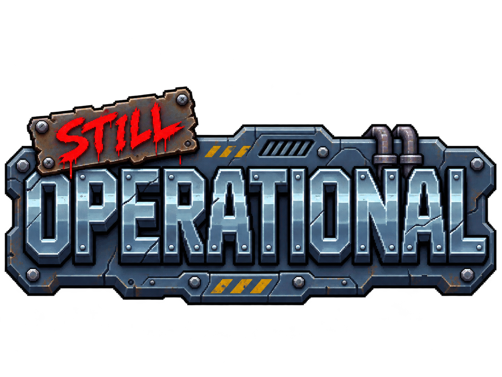

<p align="center">
  
</p>

# Still Operational

**Um zelador. Uma instalação. Lógica para manter tudo funcionando.**

Jogo educativo individual de lógica booleana, desenvolvido em Java com interface 2D em pixel art, narrativa e humor. Projeto acadêmico de Engenharia de Software II.

## Sobre o jogo

Em uma instalação quase inteiramente automatizada, o único funcionário humano precisa corrigir falhas que a inteligência artificial não consegue resolver. O sistema desperdiçou seus recursos em comandos excessivos e esqueceu o básico: lógica booleana.

O jogador assume o papel do zelador, restaura três setores e recupera os cartões físicos (tokens) necessários para reiniciar o servidor central.

O objetivo pedagógico é ensinar AND, OR e NOT por meio de situações contextualizadas, sem exigir conhecimento prévio de programação.

## Funcionalidades implementadas

- Abertura institucional da FLAMES, introdução narrativa e menu principal.
- Treinamento interativo sobre valores booleanos e operadores lógicos, com opção de pular.
- Três manutenções sequenciais: segurança, emergência e iluminação.
- Sensores interativos e seleção de operadores.
- Validação de todas as combinações de entradas aplicáveis à manutenção.
- Feedback de erro com dicas progressivas e novas tentativas sem penalidade.
- Um token por manutenção concluída.
- Sequência final de reinicialização do servidor e retorno ao menu.
- Animações, efeitos sonoros, música de fundo e ícone personalizado.
- Empacotamento portátil para Windows com ambiente Java incorporado.

## Como jogar

1. Abra o jogo, avance pela introdução ou pule para o menu.
2. Inicie uma partida e acompanhe o treinamento, se desejar.
3. Leia o diálogo e o problema de manutenção.
4. Observe as entradas, selecione AND, OR ou NOT e confirme.
5. Se a configuração estiver incorreta, leia a dica e tente novamente.
6. Após cada acerto, receba um token e continue.
7. Conclua as três manutenções para restaurar o servidor.

| Operador | Regra |
|---|---|
| AND | Verdadeiro somente quando ambas as entradas são verdadeiras. |
| OR | Verdadeiro quando pelo menos uma entrada é verdadeira. |
| NOT | Inverte a primeira entrada; a segunda não é utilizada. |

O progresso é mantido em memória durante a partida. Uma nova partida começa com zero tokens. Não há salvamento permanente, exploração livre nem modo multijogador.

## Execução pelo código-fonte

**Requisitos:** JDK 25, Apache Maven e Git. IntelliJ IDEA é recomendado, mas não obrigatório.

```bash
git clone https://github.com/otaviz/still-operational.git
cd still-operational
mvn clean package
java -cp target/still-operational-1.0-SNAPSHOT.jar com.stilloperational.JanelaPrincipal
```

No IntelliJ, abra a pasta do projeto, sincronize o Maven e execute o método `main` de `JanelaPrincipal.java`. A classe `Main.java` preserva o protótipo original em console.

## Executável Windows

O script `gerar-executavel.ps1` utiliza o jpackage do JDK para gerar uma imagem de aplicativo com runtime próprio. O arquivo `StillOperational.ico` é utilizado como ícone do executável.

Primeiro execute `mvn clean package` (ou Maven → Lifecycle → clean e package pelo IntelliJ). Em seguida, no PowerShell, na raiz do projeto:

```powershell
powershell -ExecutionPolicy Bypass -File .\gerar-executavel.ps1 -JdkHome "C:\Program Files\Java\jdk-25.0.4"
```

Substitua o caminho pelo JDK 25 instalado no computador. Caso o diretório de saída já exista, renomeie-o antes de gerar outra versão.

O resultado fica em `dist/StillOperational/`. Abra `StillOperational.exe` e mantenha as pastas `app` e `runtime` junto ao executável. A distribuição não exige instalação separada do Java, em sistemas Windows compatíveis com a arquitetura do pacote. A pasta `dist` é ignorada pelo Git.

O executável foi validado manualmente no computador do desenvolvedor. A compatibilidade em outros computadores ainda requer validação.

## Arquitetura

O código utiliza Java orientado a objetos, Swing/AWT e Java Sound, sem dependências externas de execução.

| Componente | Responsabilidade |
|---|---|
| `Operador` | Enumeração e execução das operações booleanas. |
| `Manutencao` | Record que representa o desafio e valida as combinações de entradas. |
| `Jogo` | Estado da partida, sequência de desafios e tokens. |
| `JanelaPrincipal` | Navegação entre telas, transições e ciclo de vida da janela. |
| `PainelFlames`, `PainelIntroducao`, `PainelApresentacao` | Abertura e narrativa. |
| `PainelMenu`, `PainelTreinamento`, `PainelMonologo` | Menu, ensino interativo e contextualização. |
| `PainelJogo`, `PainelFinal` | Desafios, feedback, recompensas e encerramento da partida. |
| `BotaoPixel`, `FonteJogo` | Componentes e tipografia da interface. |
| `AudioJogo` | Reprodução, cache e liberação de recursos de áudio. |
| `Main` | Protótipo em console preservado como referência. |

```text
still-operational/
├── src/
│   ├── main/
│   │   ├── java/com/stilloperational/
│   │   └── resources/
│   │       └── audio/
│   └── test/java/com/stilloperational/
├── pom.xml
├── StillOperational.ico
├── gerar-executavel.ps1
└── README.md
```

## Testes e validação

JUnit 5.11.4 e Maven Surefire 3.5.2.

| Classe de teste | Escopo | Testes |
|---|---|---:|
| OperadorTest | Tabelas-verdade de AND, OR e NOT | 3 |
| ManutencaoTest | Respostas corretas e incorretas | 2 |
| JogoTest | Estado inicial, avanço, erro sem avanço e acesso após conclusão | 4 |
| IntegracaoTest | Partida completa com erro, acertos e três tokens | 1 |
| **Total** | | **10** |

Execute `mvn test` ou Maven → Lifecycle → test no IntelliJ.

Resultado registrado no computador do desenvolvedor em 26/11/2026, às 23:49:44 (UTC−03:00), na versão de código [8f291e5](https://github.com/otaviz/still-operational/commit/8f291e5b9212f1b3d7b123df4425a2678b134d79):

```text
Tests run: 10, Failures: 0, Errors: 0, Skipped: 0
BUILD SUCCESS
```

Os testes automatizados cobrem o núcleo lógico. A interface gráfica, a narrativa, os recursos de áudio, as animações e o executável foram verificados manualmente pelo desenvolvedor; não fazem parte da cobertura automatizada apresentada.

## Histórico de desenvolvimento

O projeto evoluiu de um protótipo em console para uma aplicação gráfica completa. A revisão do código introduziu validação dos desafios, proteção contra acesso após o fim da partida, separação entre regras de negócio e apresentação, testes automatizados e controle do ciclo de vida de animações e áudio.

Protótipo de interface: [Still Operational — Figma](https://www.figma.com/design/CVCgXf5ztXF8xSbpTq3YBH/STILL-OPERATIONAL).

## Créditos

**Otávio Augusto dos Reis Nascente e Costa**  
Desenvolvimento individual — Engenharia de Software II, turma ESN3/2026-2.  
FLAMES // CODE — Burn Them Down.

A identificação e as condições de licença dos recursos de terceiros, incluindo fonte e áudio, devem ser verificadas antes de redistribuição pública. Este repositório não declara uma licença de redistribuição para esses recursos.
